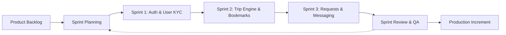
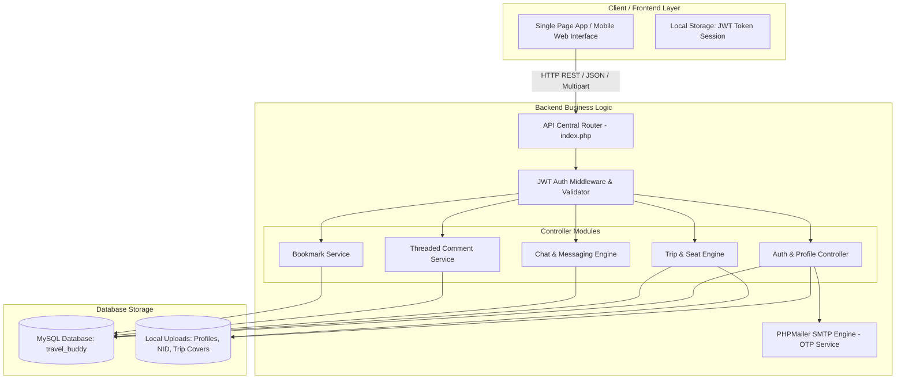
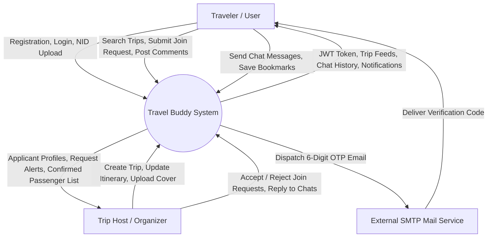
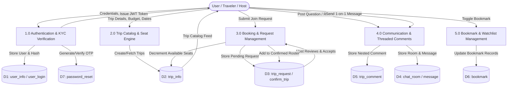
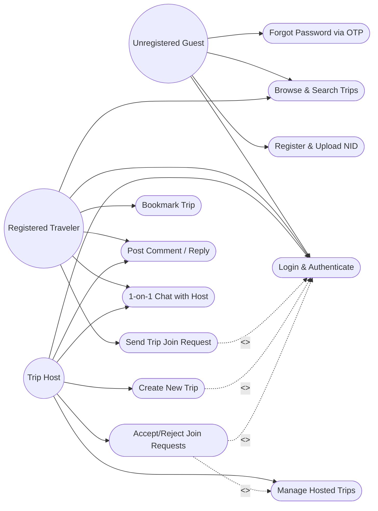
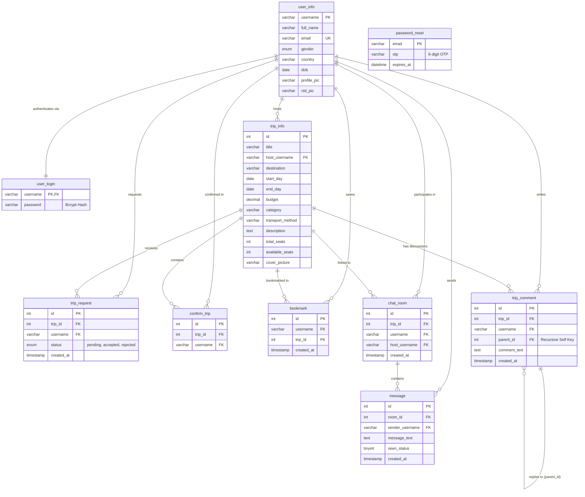
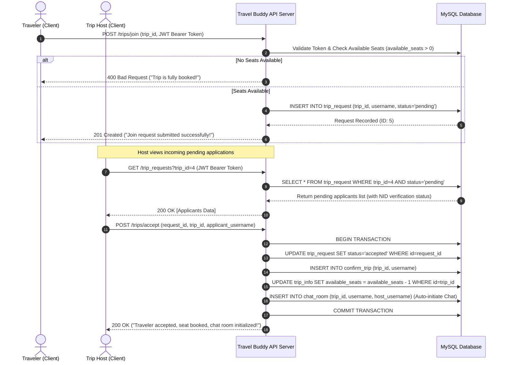

# Software Engineering Project Proposal: Travel Buddy
**A Secure, Collaborative Travel Companion Matching & Trip Management Platform**

---

## 1. Executive Summary & Problem Statement

### 1.1 Problem Statement
Traveling solo or organizing group tours often introduces significant friction:
- **Budget Inefficiencies:** Solo travelers absorb the total costs of accommodation, private rentals, and vehicle bookings without cost-sharing.
- **Safety & Trust Deficit:** Connecting with unknown travelers over unstructured social platforms (e.g., Facebook groups) carries safety risks due to lack of identity verification (KYC/NID).
- **Disorganized Coordination:** Trip planning involves fragmented tools—posts on social media, negotiations over WhatsApp/Messenger, and unorganized spreadsheets—leading to missed updates, unconfirmed headcounts, and seat overbooking.

### 1.2 Proposed Solution: "Travel Buddy"
**Travel Buddy** is a centralized, role-based collaborative travel platform that bridges the gap between travel organizers ("Hosts") and adventure seekers ("Travelers"). The platform provides:
- Verified traveler profiles through government NID picture verification.
- Structured trip creation with seat tracking, categorized budgets, and itineraries.
- Formal trip request, host review, and confirmation workflows.
- Threaded trip discussion boards and secure 1-on-1 private messaging.
- Role-based JWT security and automated OTP email verification.

---

## 2. Software Development Life Cycle (SDLC) Model

### Methodology: Agile Scrum
For the Software Engineering lifecycle of Travel Buddy, the **Agile Scrum** methodology is adopted.

**Justification:**
1. **Incremental Delivery:** Core modules (Authentication, Trip Listing) were built and tested first, followed by complex interactive modules (Trip Requests, Seat Calculation, Threaded Comments, Real-time Chat).
2. **Postman API Integration Testing:** Each sprint concludes with automated regression testing using Postman API test collections.
3. **Flexibility:** Allows continuous refinement of user experience based on feedback before final deployment.

---

## 3. System Requirements Specification (SRS)

### 3.1 Functional Requirements (FR)
- **FR-01: Identity Verification & Authentication**
  - Users must register with username, email, full name, profile photo, and NID document image.
  - Passwords must be hashed using `bcrypt` (cost factor 10).
  - JWT tokens must authenticate all protected API endpoints.
  - Password recovery must enforce time-expiring 6-digit OTP verification via SMTP mailer.
- **FR-02: Trip Lifecycle Management**
  - Verified hosts can publish trips specifying destination, budget, date range, transport method, cover photo, category, and total seats.
  - Hosts can update or cancel their hosted trips.
  - Travelers can browse, filter by category (e.g., Adventure, Relaxation), and search trips.
- **FR-03: Trip Join Request & Seat Allocation Engine**
  - Registered travelers can submit join requests (`pending` status).
  - Hosts can accept or reject requests.
  - Accepting a request decrements `available_seats` and commits the traveler to `confirm_trip`.
  - Seat overbooking must be prevented at the database/transaction level.
- **FR-04: Threaded Trip Community Discussions**
  - Users can post public questions on trip details.
  - Hierarchical parent-child replies (`parent_id`) must allow organized Q&A threads.
- **FR-05: Integrated Private Messaging System**
  - Auto-generated chat rooms between host and accepted/interested travelers.
  - Message exchange with read receipts (`seen_status`).
- **FR-06: Bookmark & Watchlist Management**
  - Users can save prospective trips to their personal watchlist for rapid tracking.

### 3.2 Non-Functional Requirements (NFR)
- **NFR-01: Security & Confidentiality:** Passwords stored only as one-way cryptographic hashes. Sensitive NID documents protected on server storage with restricted access permissions.
- **NFR-02: Performance & Response Time:** REST API endpoints respond in < 200 ms under standard loads. Database queries optimized with foreign keys and compound unique indexes.
- **NFR-03: Data Integrity & ACID Compliance:** Referential integrity enforced via MySQL foreign keys with cascading deletes (`ON DELETE CASCADE`) to prevent orphaned comments, bookmarks, and chat records.
- **NFR-04: Usability & Responsiveness:** Cross-platform responsiveness across mobile, tablet, and desktop viewports.
- **NFR-05: Maintainability:** Modular API routing architecture with distinct separation of concerns (`routes/auth`, `routes/trips`, `routes/chat`, `routes/comments`, `routes/bookmarks`).

---

## 4. Software Engineering Design Diagrams

### 4.1 System Architecture Diagram (3-Tier Architectural Pattern)

---

### 4.2 Data Flow Diagrams (DFD)

#### DFD Level 0 (Context Diagram)

---

#### DFD Level 1 (Decomposition Diagram)

---

### 4.3 Use Case Diagram (UML)

---

### 4.4 Entity-Relationship Diagram (ERD / Relational Schema)

---

### 4.5 Sequence Diagram: Trip Join Request & Acceptance Workflow

---

## 5. Software Quality Assurance (SQA) & Testing Strategy

### 5.1 Automated API Testing (Postman Test Suite)
The Travel Buddy backend includes a comprehensive, automated Postman Collection (`travel_buddy_postman_collection.json`) evaluating:
1. **Status Code Assertions:** `pm.response.to.have.status(200 / 201)`
2. **Environment Token Persistence:** Automatic parsing of issued JWT tokens from `/auth/login` and `/auth/registration` into collection runtime variables.
3. **Multipart Form-Data Validation:** Verification of file uploads (`profile_pic`, `nid_pic`, `cover_picture`) alongside JSON payloads.
4. **Boundary Condition Testing:** Attempting to join a trip with `available_seats = 0` or submitting invalid OTPs.

### 5.2 Security & Vulnerability Analysis
- **SQL Injection Prevention:** 100% of queries use PDO Prepared Statements with bound parameters (`$stmt->prepare()`, `$stmt->execute()`).
- **Authentication Hijacking Defense:** Stateless JWT signatures using secret key verification and explicit expiration timestamps.
- **Cross-Site Scripting (XSS) Sanitization:** Stripping tags and escaping inputs prior to storing comments and chat messages.

---

## 6. Risk Assessment & Mitigation Plan

| Risk ID | Identified Risk | Impact | Probability | Mitigation Strategy |
| :--- | :--- | :--- | :--- | :--- |
| **R-01** | Fraudulent / Fake Traveler Profiles | High | Medium | Mandatory National ID (NID) image upload during registration; Host review before acceptance. |
| **R-02** | Race Conditions in Seat Booking | High | Low | Atomic SQL transactions and check-before-decrement logic when approving join requests. |
| **R-03** | Unauthorized API Access | High | Medium | JWT middleware interceptor checking bearer tokens on all mutating endpoints. |
| **R-04** | Spam in Public Comment Threads | Medium | Medium | Foreign key enforcement and recursive parent-child moderation by trip hosts. |

---

## 7. Future Software Enhancements (Academic Roadmap)
1. **Escrow Payment Gateway Integration:** Integration of bKash/Nagad/SSLCommerz API to hold booking deposits until trip completion.
2. **Real-time WebSockets Engine:** Migrating HTTP polling chat into real-time WebSockets (Socket.io / Ratchet PHP) for instant message delivery.
3. **AI Companion Recommendation:** Machine Learning clustering based on travel budget, preferred destinations, and past traveler ratings.
4. **Trust Score & Review System:** Mutual 5-star ratings and verified traveler badges awarded upon completion of confirmed trips.
